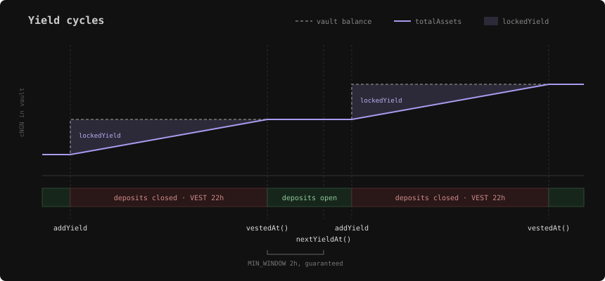

# StreamingYieldVault

`StreamingYieldVault` is an [ERC-4626](https://eips.ethereum.org/EIPS/eip-4626) tokenized vault in [`@hyperbridge/core`](https://github.com/polytope-labs/hyperbridge/tree/main/sdk/packages/core). It lets an issuer turn a manual, per-user yield-distribution process into a single periodic transfer: the owner streams yield into the vault and every holder's share value rises automatically. Holders receive a standard, non-rebasing, composable share token.

It is a self-contained primitive with no Hyperbridge or ISMP dependency. It can be used on any EVM chain on its own.

## Yield Bearing cNGN (ycNGN)

ycNGN is a `StreamingYieldVault` over cNGN on Base. Deposit cNGN to receive ycNGN. Redeem ycNGN to get your cNGN back, together with the yield it has earned.

| Field | Value |
| --- | --- |
| Chain | Base (`EVM-8453`) |
| Vault and share token (ycNGN) | [`0xa82A3531021317240Fb32E67f9c7bC091F737D3b`](https://basescan.org/address/0xa82A3531021317240Fb32E67f9c7bC091F737D3b) |
| Underlying asset (cNGN) | [`0x46C85152bFe9f96829aA94755D9f915F9B10EF5F`](https://basescan.org/address/0x46C85152bFe9f96829aA94755D9f915F9B10EF5F) |
| ycNGN decimals | 12 |
| cNGN decimals | 6 |

<Callout type="warn">
ycNGN is not 1:1 with cNGN. Each share is worth more cNGN as yield vests. A share also has 6 more decimals than cNGN, from the vault's virtual-share offset. Price ycNGN with `convertToAssets` or `previewRedeem`, never by shifting decimals.
</Callout>

The deposit and redeem examples below use the ycNGN addresses. The same calls work for any `StreamingYieldVault`.

## How it works

Yield is not recognized instantly. Each tranche the owner adds is recognized linearly over a fixed window, `VEST`, which is 22 hours. The exchange rate is:

```
totalAssets = asset.balanceOf(vault) − lockedYield
```

`lockedYield` is the part of the current tranche that has not vested yet. The vault exposes it as `lockedYield()`.



When the owner calls `addYield`, the vault balance jumps but `totalAssets` does not. The new yield starts out fully locked. Over the next 22 hours it unlocks linearly, and the share price climbs with it. Deposits stay closed for that whole stretch. They reopen at `vestedAt()` and stay open at least until `nextYieldAt()`.

Vesting is keyed on `block.timestamp`, so a deposit and a withdrawal in the same block see the same share price. Nobody can sandwich a yield event. Adding yield never moves the price in the same block either. The price only rises as the tranche vests.

Deposits and mints are closed while a tranche vests. New capital can only enter after a tranche has fully vested and before the next one starts. A latecomer never shares yield meant for the holders who were already in.

`addYield` reverts until the previous tranche has vested, so tranches never overlap. It also has to wait `MIN_WINDOW`, 2 hours, past the end of vesting. That guarantees a deposit window of at least 2 hours every cycle, from `vestedAt()` to `nextYieldAt()`, however promptly the keeper runs.

The first-depositor inflation attack is mitigated with OpenZeppelin's virtual shares and assets. A seed-and-burn at deployment is still recommended.

## Depositing

Deposits are not always open. Each time the owner adds yield, deposits close for 22 hours while that yield vests. Redemptions are not affected.

So check `maxDeposit(receiver)` before every deposit. It returns `0` while deposits are closed and `type(uint256).max` while they are open. A deposit sent while they are closed reverts with `ERC4626ExceededMaxDeposit(receiver, assets, 0)`. `maxMint` follows the same rule for `mint`.

<Callout type="warn">
`previewDeposit` does not check whether deposits are open. It keeps quoting shares while they are closed. Only `maxDeposit` and `maxMint` show the lock.
</Callout>

<Steps>
<Step>
### Set up

The examples use [viem](https://viem.sh), which ships the standard ERC-20 and ERC-4626 ABIs. Start with the two addresses, the vault ABI and a pair of clients. Redeeming uses the same setup.

```typescript lineNumbers
import {
  createPublicClient, createWalletClient, http,
  erc20Abi, erc4626Abi, parseAbi,
  formatUnits, parseUnits,
} from "viem"
import { privateKeyToAccount } from "viem/accounts"
import { base } from "viem/chains"

const YCNGN = "0xa82A3531021317240Fb32E67f9c7bC091F737D3b"
const CNGN = "0x46C85152bFe9f96829aA94755D9f915F9B10EF5F"

// The standard ERC-4626 ABI, plus the vault's own vestedAt().
const vaultAbi = [
  ...erc4626Abi,
  ...parseAbi(["function vestedAt() view returns (uint256)"]),
]

const account = privateKeyToAccount("0xYOUR_KEY")
const transport = http("YOUR_RPC")
const publicClient = createPublicClient({ chain: base, transport })
const walletClient = createWalletClient({
  account,
  chain: base,
  transport,
})
```
</Step>
<Step>
### Check that deposits are open

Read `maxDeposit` for the receiver. If it is below the amount, deposits are closed, and `vestedAt()` tells you when they reopen.

```typescript lineNumbers
const amount = parseUnits("100000", 6) // 100,000 cNGN

const maxDeposit = await publicClient.readContract({
  address: YCNGN,
  abi: vaultAbi,
  functionName: "maxDeposit",
  args: [account.address],
})

if (maxDeposit < amount) {
  const reopensAt = await publicClient.readContract({
    address: YCNGN,
    abi: vaultAbi,
    functionName: "vestedAt",
  })
  const reopens = new Date(Number(reopensAt) * 1000).toISOString()
  throw new Error(`ycNGN deposits reopen at ${reopens}`)
}
```

Once deposits reopen, they stay open at least until `nextYieldAt()`. After that, the owner can add yield at any moment.
</Step>
<Step>
### Approve the vault

The vault pulls the cNGN from you. Approve it, and wait for the approval to land.

```typescript lineNumbers
const approval = await walletClient.writeContract({
  address: CNGN,
  abi: erc20Abi,
  functionName: "approve",
  args: [YCNGN, amount],
})
await publicClient.waitForTransactionReceipt({ hash: approval })
```
</Step>
<Step>
### Simulate, then deposit

A deposit that passed the check can still revert if the owner adds yield before it lands. Simulating right before you send narrows that gap, but it cannot close it, so handle a revert.

```typescript lineNumbers
const deposit = await publicClient.simulateContract({
  account,
  address: YCNGN,
  abi: vaultAbi,
  functionName: "deposit",
  args: [amount, account.address],
})
const depositHash = await walletClient.writeContract(deposit.request)
await publicClient.waitForTransactionReceipt({ hash: depositHash })
```
</Step>
</Steps>

A Solidity contract makes the same check, and only deposits while deposits are open.

```solidity lineNumbers
import {StreamingYieldVault} from "@hyperbridge/core/vaults/StreamingYieldVault.sol";
import {IERC20} from "@openzeppelin/contracts/token/ERC20/IERC20.sol";

StreamingYieldVault constant YCNGN = StreamingYieldVault(0xa82A3531021317240Fb32E67f9c7bC091F737D3b);
IERC20 constant CNGN = IERC20(0x46C85152bFe9f96829aA94755D9f915F9B10EF5F);

if (YCNGN.maxDeposit(receiver) >= amount) {
    CNGN.approve(address(YCNGN), amount);
    uint256 shares = YCNGN.deposit(amount, receiver);
}
```

## Redeeming

Redemptions are always open. The vesting lock only applies to deposits and mints.

Redeeming while a tranche vests pays out the yield vested so far. The unvested rest stays in the vault for the holders who remain.

<Steps>
<Step>
### Read the position

`maxRedeem(owner)` is the owner's full ycNGN balance. Redeem all of it to exit completely.

```typescript lineNumbers
const shares = await publicClient.readContract({
  address: YCNGN,
  abi: vaultAbi,
  functionName: "maxRedeem",
  args: [account.address],
})
```
</Step>
<Step>
### Quote the cNGN out

`previewRedeem` returns the cNGN those shares are worth at the current price.

```typescript lineNumbers
const cngnOut = await publicClient.readContract({
  address: YCNGN,
  abi: vaultAbi,
  functionName: "previewRedeem",
  args: [shares],
})
const ycngnIn = formatUnits(shares, 12)
const cngnOutText = formatUnits(cngnOut, 6)
console.log(`Redeeming ${ycngnIn} ycNGN for ${cngnOutText} cNGN`)
```
</Step>
<Step>
### Redeem

`redeem(shares, receiver, owner)` burns the shares and sends the cNGN to `receiver`. A caller other than `owner` needs a ycNGN allowance from the owner first.

```typescript lineNumbers
const redeem = await publicClient.simulateContract({
  account,
  address: YCNGN,
  abi: vaultAbi,
  functionName: "redeem",
  args: [shares, account.address, account.address],
})
const redeemHash = await walletClient.writeContract(redeem.request)
await publicClient.waitForTransactionReceipt({ hash: redeemHash })
```
</Step>
</Steps>

To take out an exact cNGN amount instead, use `withdraw(assets, receiver, owner)`. It burns however many shares that amount costs.

From a Solidity contract, a full exit looks like this.

```solidity lineNumbers
uint256 shares = YCNGN.maxRedeem(owner);
uint256 assets = YCNGN.redeem(shares, receiver, owner);
```

## Deploying your own vault

<Callout type="info">
The vault assumes a standard ERC-20 asset: non-rebasing, non-fee-on-transfer, and without *automatic* transfer callbacks (no ERC-777 `tokensReceived` hooks). [ERC-1363](https://eips.ethereum.org/EIPS/eip-1363) assets are supported and let the owner fund yield in a single transaction (see [Add yield](#add-yield)). Wrap exotic tokens before using them as the underlying.
</Callout>

<Steps>
<Step>
### Install the package

<Tabs items={['pnpm', 'yarn', 'npm']}>
<Tab value="pnpm">
```bash
pnpm add @hyperbridge/core
```
</Tab>
<Tab value="yarn">
```bash
yarn add @hyperbridge/core
```
</Tab>
<Tab value="npm">
```bash
npm install @hyperbridge/core
```
</Tab>
</Tabs>
</Step>
<Step>
### Deploy the vault

The constructor takes the underlying asset, the share token name/symbol, and the owner.

```solidity lineNumbers
import {StreamingYieldVault} from "@hyperbridge/core/vaults/StreamingYieldVault.sol";
import {IERC20} from "@openzeppelin/contracts/token/ERC20/IERC20.sol";

StreamingYieldVault vault = new StreamingYieldVault(
    IERC20(USDC),        // underlying asset (standard ERC-20)
    "Yield USDC",        // share token name
    "yUSDC",             // share token symbol
    MULTISIG             // owner (controls addYield)
);
```

<Callout type="warn">
Set the owner to a **multisig or timelock**, never an EOA. The owner supplies yield via `addYield`.
</Callout>
</Step>
<Step>
### Seed and burn

Make a small first deposit and burn the shares so the vault is never empty. Together with the built-in decimals offset, this fully closes the first-depositor inflation attack.

```solidity lineNumbers
IERC20(USDC).approve(address(vault), 1e6);
uint256 shares = vault.deposit(1e6, address(this));
vault.transfer(address(0xdead), shares); // burn
```
</Step>
<Step>
### Add yield

`addYield(uint256 amount)` is owner-only. It pulls `amount` of the underlying from the caller and streams it over `VEST`. Have your treasury or keeper call it on a regular cadence, such as daily.

```solidity lineNumbers
IERC20(USDC).approve(address(vault), amount);
vault.addYield(amount);
```

The minimum cadence is 24 hours, `VEST` plus `MIN_WINDOW`. `addYield` reverts with `YieldStillVesting(vestedAt)` while the previous tranche is still vesting. It reverts with `DepositWindowOpen(closesAt)` until `MIN_WINDOW` has passed since the vest end, which keeps a deposit window open every cycle. A zero amount reverts with `ZeroAmount()`. Each tranche emits `YieldAdded(amount, vestingStart)` when it starts vesting.

Use `nextYieldAt()` for the earliest time the next `addYield` is allowed.

Always fund yield through `addYield`. A plain transfer of the asset to the vault skips vesting and raises `totalAssets` at once.

If the underlying asset is an [ERC-1363](https://eips.ethereum.org/EIPS/eip-1363) token, the owner can fund a tranche in one transaction with `transferAndCall`, with no separate `approve`. The asset moves the funds to the vault and calls its `onTransferReceived` hook, which starts the tranche.

```solidity lineNumbers
asset.transferAndCall(address(vault), amount); // same as approve + addYield
```

The same rules apply as for `addYield`. The funds must come from the owner's balance, and a top-up that `addYield` would reject reverts and rolls the transfer back. Only the asset can call `onTransferReceived`; any other caller gets `CallerNotAsset(caller)`.
</Step>
</Steps>
